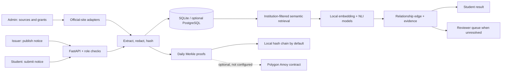

# FinalSay Project Report

**Project:** FinalSay — cross-institution notice comparison prototype  
**Evidence snapshot:** 2 November 2026  
**Repository:** local project checkout; this report makes no claim about a remote deployment  
**Application:** FastAPI, SQLAlchemy, SQLite by default, React and Vite

## Abstract

FinalSay is a prototype for comparing a notice shared by a student with official notices already stored for an institution. It extracts text and selected fields, redacts some personal identifiers, retrieves candidate notices, classifies the relationship, and records the comparison and its evidence. The supported relationship labels are consistent, contradictory, superseded, corrected, extended, cancelled, and unresolved. A low-confidence comparison can be sent for reviewer attention.

The repository includes synthetic fixtures, local semantic-model inference, source adapters for Thapar, NIT Jalandhar, and IIT Bombay, a local hash-chain/Merkle provenance path, student/reviewer/admin/issuer roles, and an issuer publishing flow. Recent changes restrict issuer publishing to explicit institution grants and enforce student ownership on private submissions. The local SQLite database currently contains 251 notices, including the synthetic Thapar test record described in this report.

The semantic benchmark uses synthetic pairs. After correcting event/date mismatches in the generated fixture set, its 21-pair temporal holdout achieved 0.295 macro-F1; the 21-pair institution holdout achieved 0.686. These results are small engineering diagnostics, not evidence of performance on real student forwards. The reported annotator agreement is generated by the fixture and is not human agreement. No Polygon transaction was submitted because a funded Amoy wallet and deployed contract are not configured.

## 1. Problem and intended use

Students often receive schedules and instructions without a dependable path back to the issuing source. A notice may be genuine but outdated, or may conflict with an official record. FinalSay aims to make relevant stored evidence and uncertainty visible. It is an aid for comparison and review; it does not establish institutional authorship or replace an institution's own notice board.

The project focuses on a local research/demo workflow:

- retrieve notices from configured institutional pages and feeds;
- accept a student's pasted text or supported document;
- compare the submission with official records for the selected institution;
- save the result, candidate evidence, and integrity metadata;
- support role-scoped review and issuer publication.

The application does not claim comprehensive institutional coverage, guaranteed text extraction, calibrated model probabilities, institutional endorsement, or autonomous detection of all misinformation.

## 2. Implementation

### 2.1 Application structure

The backend is a synchronous FastAPI service under `backend/finalsay`. SQLAlchemy models store users, institutions, notices, issuer memberships, comparison edges, review cases/decisions, benchmark pairs and annotations, scrape runs, and provenance records. Startup creates missing tables and runs the project's lightweight migrations. SQLite is the local default; PostgreSQL is an optional configured database.

The React/Vite client is in `apps/web`. It provides student notice submission and history, reviewer workflows, admin source/grant management, and issuer notice publishing. The development server proxies `/api` to the backend.

The comparison implementation is selected through configuration. The default semantic path uses local sentence embeddings for candidate retrieval and a local NLI cross-encoder for comparison. The rule-based mock path is available for deterministic demonstrations. Model scores are ranking/evidence scores and must not be read as calibrated probabilities.

### 2.2 Authentication and access control

Passwords are hashed and API sessions use signed bearer tokens. Public registration creates student accounts. Admin and issuer identities are provisioned separately through the local seed process. Issuer publishing requires an active grant for the chosen institution; the issuer cannot choose an arbitrary institution. Student detail, comparison, candidate, version, and provenance routes enforce submission ownership, with the permitted operational roles handled separately.

The seeded demo credentials are for local development only:

| Role | Email | Password |
|---|---|---|
| Student | `student@finalsay.demo` | `student123` |
| Reviewer A | `reviewer@finalsay.demo` | `reviewer123` |
| Reviewer B | `reviewer2@finalsay.demo` | `reviewer2-demo` |
| Admin | `admin@finalsay.demo` | `admin123` |
| Issuer | `issuer@finalsay.demo` | `issuer123` |

The issuer is granted publishing access to Thapar in the local seed. A local-only CLI can provision additional reviewer accounts for independent benchmark annotation (`python -m finalsay.seed.create_reviewer EMAIL`); it prompts for the password and creates reviewer role only. Production deployments must provision real accounts and grants using their own approved process and secrets; demo credentials and development defaults are not production credentials.

### 2.2 Blind reviewer benchmark workflow

Reviewer A and Reviewer B can label the same 308 benchmark pairs through **Reviewer → Benchmark**. The API binds each annotation to the authenticated reviewer account, returns only that reviewer's own labels, rejects attempts to submit another annotator's identity, and locks a pass after completion. Generated fixture annotations are excluded. Cohen's kappa and per-label agreement remain hidden until two distinct reviewer accounts complete the same full pair corpus; the corpus fingerprint invalidates completions if the pair set changes. The workflow is implemented and locally testable, but no independent human labels are available yet, so no human Cohen's kappa has been measured.

### 2.3 Notice acquisition and provenance

The source adapters support the configured Thapar notice board, IIT Bombay Academic Office pages, and NIT Jalandhar's academic notice API. The database records scrape runs and distinguishes found, created, modified, unchanged, and error outcomes. Source acquisition may be partial when a link is stale or a document has no extractable text.

Notice records retain a source URL, retrieved timestamp, content hash, and version relationship where applicable. Local Merkle roots and an append-only hash chain support integrity checks against stored evidence. They do not prove that the source was genuinely issued by the institution. The optional Polygon Amoy adapter is present but is not configured or externally verified in this environment.

## 3. Current local database snapshot

The SQLite file `backend/finalsay.db` contains 14 application tables, five seeded demo accounts (including two local reviewer accounts), six institutions, 251 notices (168 official and 83 student submissions), 83 relation edges, 42 review cases, 308 benchmark pairs, 616 generated benchmark annotations, eight local daily roots, eight local anchor-chain blocks, and 251 Merkle proofs. No independent human benchmark annotations have been collected; generated labels must not be reported as two-person agreement. Counts are a snapshot and may change as the demo is used. The multiple roots for a day reflect refreshed historical trees; current proofs point to the latest tree for their date.

The active source adapters at the time of the snapshot were Thapar and IIT Bombay. NIT Jalandhar was disabled after the last poll failed with a connection reset. The latest Thapar run found 23 notices, modified 6, left 17 unchanged, and was partial because one PDF returned 404. The latest IIT Bombay run found 10 notices, modified 8, left 2 unchanged, and was partial because one old PDF yielded no extractable text. These are recorded local poll results, not proof that every notice on those websites was captured.

### 3.1 Test notice and student comparison

The requested test record is saved as official notice **#189**:

| Field | Saved value |
|---|---|
| Institution | Thapar Institute of Engineering and Technology |
| Title | Revised Schedule for End-Semester Examinations |
| Date | 01 November 2026 |
| Text | The End-Semester Examinations for the odd semester will commence from 15 December 2026. |
| SHA-256 | `99858c141064bb4416870f3dde7e2d6d38227189ab883ab43ddb755a88e890e5` |
| Source URL | `https://example.test/thapar/notices/revised-end-semester-examinations-2026-11-01` |

This is a synthetic test record. The placeholder URL is not a Thapar publication and the database entry does not establish institutional authenticity. Publishing identical content reuses the matching current notice instead of creating a duplicate.

Student submission **#245**, submitted through the student UI, retrieved notice #189 at rank 1 and was classified `superseded` by `semantic-nli-deberta-v3-small` with raw score 0.9992. Submission **#244** is an earlier equivalent comparison. An exact-content submission **#248** retrieved #189 at rank 1 and was classified `consistent` with raw score 0.974. An ambiguous submission **#246** was classified `unresolved`; reviewer case #42 was then confirmed as unresolved and closed through the reviewer UI. These demonstrate local retrieval, comparison, and review workflows; they are not accuracy estimates.
Student submission **#245**, submitted through the student UI, retrieved notice #189 at rank 1 and was classified `superseded` by `semantic-nli-deberta-v3-small` with raw score 0.9992. Submission **#244** is an earlier equivalent comparison. An exact-content submission **#248** retrieved #189 at rank 1 and was classified `consistent` with raw score 0.974. An ambiguous submission **#246** was classified `unresolved`; reviewer case #42 was then confirmed as unresolved and closed through the reviewer UI. After fixing a false issuer fallback in body-only submissions, submission **#251** retrieved #189 at rank 1 and was classified `contradictory` for the 15 December versus 20 December exam dates; its extracted issuer correctly remains missing. Earlier pre-restart run #250 retains the old fallback value and is not the corrected extraction example. These demonstrate local retrieval, comparison, and review workflows; they are not accuracy estimates.

## 4. Synthetic evaluation

### 4.1 Dataset and method

The deterministic fixture generator creates 120 synthetic official notices and 65 synthetic student submissions across three fictional institutions. A 30-pair validation slice from Northgate and Riverside is used to select thresholds. Temporal and institution holdouts each contain 21 pairs. The benchmark's 308 pair rows are a separate display/review dataset and are not the classification test sample size.

An audit found that previous gold submissions sometimes pointed to an unrelated exam date or to a notice with no matching deadline. The generator was corrected so date-conflict pairs use the paired official's date, extension pairs use registration notices with an actual deadline, and venue corrections refer to a venue in the official text. Fixture JSON was regenerated from the deterministic generator without reseeding or changing the local notice database.

### 4.2 Current semantic-model results

Results below are from `docs/phase1-ml-evaluation.md`, generated offline with the cached `semantic-nli-deberta-v3-small` model. The benchmark selected a candidate-similarity acceptance floor of 0.20 and a comparison-score floor of 0.20 on validation. The running service's retrieval filter is separately configured at cosine 0.55 by default, and its comparison-score floor is 0.20; benchmark coverage numbers use the benchmark's explicit 0.20 acceptance floor.

| Split | Pairs | Accuracy | Macro-F1 | Candidate recall@1 | Unresolved rate | Median latency |
|---|---:|---:|---:|---:|---:|---:|
| Validation (Northgate + Riverside) | 30 | 0.867 | 0.810 | 0.533 | 0.133 | 48.1 ms |
| Temporal holdout | 21 | 0.429 | 0.295 | 0.476 | 0.286 | 46.5 ms |
| Institution holdout (Summit) | 21 | 0.714 | 0.686 | 0.429 | 0.190 | 44.8 ms |

The difference between validation and temporal holdout is material. In particular, the model performed poorly on corrected, extended, and cancelled naturalistic temporal examples. The sample is small, synthetic, and authored by the same project; it is useful for detecting regressions and integration defects, not for claiming general accuracy. The evaluation report includes per-class scores and confusion matrices.

The `two_annotator_kappa` figure in the generated evaluation is **0.625 from deterministic seed annotations**. Those labels are generated by fixture rules, not independently supplied by two people. Do not present this value as measured human agreement. The `nli` and `prompted_llm` entries in the evaluator are heuristic cue baselines, not calls to an independent NLI service or hosted LLM.

## 5. Verification performed

After the fixture corrections and issuer/ownership changes:

- Full backend test suite after the blind annotation and Polygon mock-integration changes: **100 passed**; only dependency/deprecation warnings were emitted.
- Frontend TypeScript/Vite production build: passed; 108 modules transformed and PWA assets generated.
- Blind benchmark API tests cover reviewer identity binding, same-corpus independent annotations, generated-label exclusion, completion locking, and kappa visibility only after both passes; the local UI showed 308 unlabelled pairs for Reviewer A and Reviewer B.
- Offline semantic benchmark: rerun with cached model weights and wrote `docs/phase1-ml-evaluation.md`; metrics remain consistent with the previous snapshot (small latency variation).
- Local database inspection: confirmed notice #189, its SHA-256, the #245 → #189 `superseded` relation, the #248 → #189 `consistent` relation, the #251 → #189 `contradictory` relation, and reviewer case #42 closed with label `unresolved`.
- Authenticated API checks: the synthetic issuer logged in and saw only its granted Thapar institution; `POST /api/issuer/publish` returned HTTP 201 for the repeated test request and reused notice #189. The student candidate endpoint returned notice #189 at rank 1 for submission #244 (semantic similarity 0.5998).
- Integrity checks: the admin UI refreshed the 2 November 2026 root to root #8, covering 62 notices created that UTC date. All 251 notices have Merkle proofs. Student UI verification of #251 returned `integrity_ok=true` against the local root; prior UI tamper simulation of #248 returned `integrity_ok=false` and `simulated_tamper=true`. These are local integrity checks, not Polygon confirmation.
- HTTP/UI servers: the existing backend and Vite processes are bound to `127.0.0.1:8000` and `127.0.0.1:5173` respectively. They should be checked with the readiness URL after restart or network-permission changes.

The checks above do not establish an external production deployment, full browser accessibility, a security certification, load capacity, or live blockchain confirmation.

## 6. Local demonstration and publishing

Open the application at <http://127.0.0.1:5173/FinalSay-prototype/> and API documentation at <http://127.0.0.1:8000/docs>. Sign in using the local credentials above. As the issuer, use **Issuer → Publish**, select Thapar, and submit the title, date, source URL, and notice text. As a student, submit a later-date version against Thapar and inspect the saved result and candidate evidence. An admin can build or refresh integrity proofs from **Admin → Provenance**, selecting the notice creation date in UTC; rebuilding an unchanged tree reuses its existing anchor.

For API publishing, log in with form-encoded credentials at `POST /api/auth/login`, then send the returned bearer token to `POST /api/issuer/publish`. The full request, including a shell example, is in [`integrated-demo-guide.md`](integrated-demo-guide.md). If the issuer has not been granted Thapar access, an admin must first grant it through **Admin → Sources → Issuer publishing grants**. The endpoint rejects ungranted or inactive institutions.

## 7. Limitations and next work

1. **Real labeled evaluation:** use the reviewer-account CLI to collect independent judgments on approved real notice pairs, document disagreements, freeze grouped temporal/institution holdouts, and report confidence intervals. The current kappa is generated seed agreement, not human agreement.
2. **Candidate retrieval:** improve event identity matching and evaluate recall@k/top-candidate correctness separately from relationship classification. Do not tune against the holdout.
3. **Source coverage:** resolve stale PDFs and NIT Jalandhar connectivity, record freshness, and make partial extraction visible.
4. **Operational hardening:** configure non-demo credentials and production secrets, backup/restore, rate limiting, retention, monitoring, and production migration procedures.
5. **External anchoring:** only claim Polygon verification after a funded test wallet, deployed contract, confirmed receipt, and independent lookup are available.

The current appropriate characterization is a locally runnable research prototype with real-source connectors, private student workflows, and synthetic evaluation. It is not yet a validated institutional decision system.

## Appendix: key local paths

- Backend application: `backend/finalsay/main.py`
- Issuer publication and grants: `backend/finalsay/api/issuer.py`, `backend/finalsay/api/issuer_memberships.py`
- Models and persistence: `backend/finalsay/models.py`, `backend/finalsay/db.py`
- Fixture generator: `backend/finalsay/seed/dataset.py`
- Evaluation output: `docs/phase1-ml-evaluation.md`
- API publishing guide: `docs/integrated-demo-guide.md`
- Optional Polygon contract: `contracts/FinalSayAnchor.sol`
